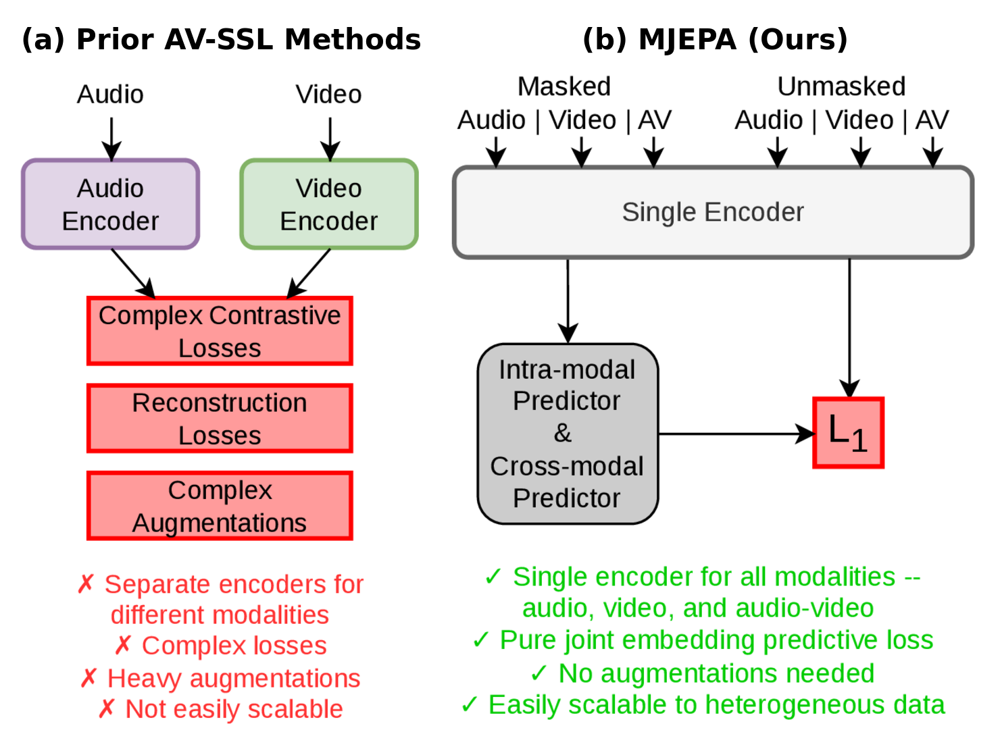
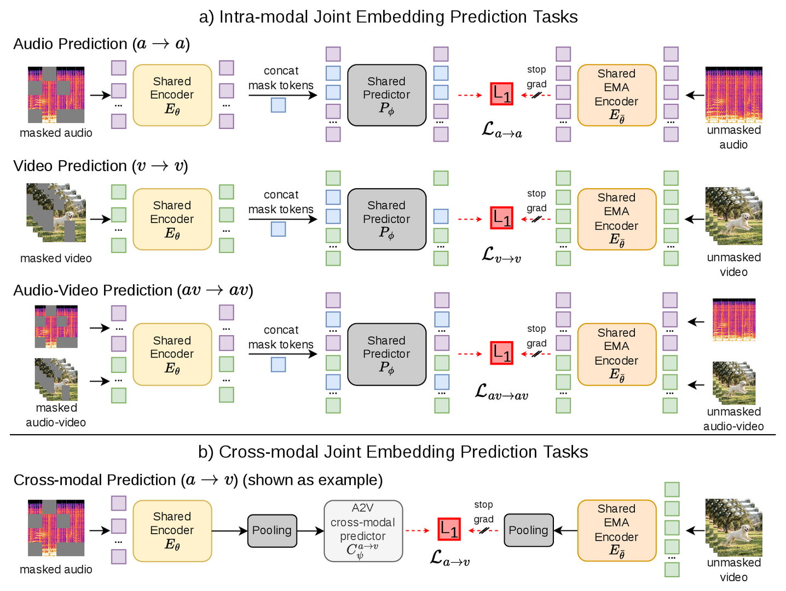

# MJEPA: A Simple and Scalable Joint-Embedding Predictive Architecture for Audio-Visual Learning

Revant Teotia, Adrien Bardes, Michael Rabbat, Sumit Chopra, Matthew Muckley*, Nicolas Ballas*

*Equal supervision

[[`Paper`](https://arxiv.org/abs/2606.25225)] [[`BibTeX`](#citation)]

Official PyTorch implementation of MJEPA.

MJEPA is a self-supervised audio-visual learning framework that trains a **single, unified encoder** for both audio and video using only **joint-embedding predictive (JEPA) objectives**. Cross-modal prediction enables positive transfer across modalities, and the approach scales to 1B-parameter models with heterogeneous data mixtures.

<p align="center">
  
</p>

## Highlights

- **Simple architecture**: single shared encoder + single JEPA objective, applied within and across modalities
- **Cross-modal prediction**: each modality's representation improves the other - without it, a shared encoder degrades below unimodal baselines
- **Strong frozen representations**: frozen features outperform prior SSL baselines and are competitive with fully finetuned models
- **Scalable**: scales naturally to 1B-parameter ViT-g and heterogeneous data mixtures (paired audio-video + video-only)

## Method

One shared encoder and one L1 prediction loss in embedding space are applied to
every prediction task. Intra-modal tasks predict masked representations within an input mode (audio→audio, video→video, audio-video→audio-video). Cross-modal tasks predict
one mode's pooled representation from another. Targets always come from an EMA
copy of the encoder, with a stop-gradient on the target branch.

The overall training loss is the sum of three intra-modal and six cross-modal
prediction losses. The figure below shows all three intra-modal prediction tasks
and, as an example, one of the six cross-modal ones (a→v).

<p align="center">
  
</p>

## Results

Reported in the [paper](https://arxiv.org/abs/2606.25225). All numbers use a
frozen encoder with an attentive probe trained on top.

#### Audio-Video Frozen Evaluation on AudioSet-20K (mAP)

| Model | Audio | Video | Audio-Video |
|---|---|---|---|
| EquiAV (best prior) | 34.25 | 18.60 | 38.60 |
| **MJEPA ViT-L** | 38.89 | 25.38 | 42.90 |
| **MJEPA ViT-L + data scaling** | 40.00 | 29.63 | 45.31 |
| **MJEPA ViT-g + data scaling** | **40.97** | **29.82** | **45.44** |

#### Audio-Only Frozen Evaluation

| Model | AS20K (mAP) | ESC-50 (Acc) | FSD50K (mAP) |
|---|---|---|---|
| **MJEPA ViT-L** | 38.9 | 95.2 | 63.9 |
| **MJEPA ViT-L + data scaling** | 40.0 | 96.8 | 65.5 |
| **MJEPA ViT-g + data scaling** | **40.9** | **96.9** | **65.8** |

#### Video-Only Frozen Evaluation (Top-1 Accuracy)

| Model | Pre-train Data | K400 | SSv2 |
|---|---|---|---|
| VJEPA2 ViT-L | VM22M | 85.1 | 73.7 |
| VJEPA2 ViT-g | VM22M | **86.6** | **75.3** |
| **MJEPA ViT-L + data scaling** | AS2M + VM2M | 84.7 | 73.3 |
| **MJEPA ViT-g + data scaling** | AS2M + VM2M | 85.0 | 73.9 |

## Installation

```bash
conda create -n mjepa python=3.11 -y
conda activate mjepa
pip install -r requirements.txt
```

## Data Preparation

MJEPA reads plain index files (CSV/JSON). See [`sample_data/`](sample_data/), which
contains real index files truncated to five rows with the paths replaced by
placeholders. Read [`sample_data/README.md`](sample_data/README.md) for more details.

VideoMix2M is the Kinetics-710 + Something-Something v2 + HowTo100M mixture. See
[V-JEPA 2](https://github.com/facebookresearch/vjepa2) for its composition.

Every config ships with `/path/to/...` placeholders. Update the dataset paths,
the `folder` output directory, and (for evals) the `checkpoint` path before
launching.

## Pre-training

All pre-training is launched via SLURM with `submitit`. Pass your own cluster
account, partition, and QoS via `--account`, `--partition`, and `--qos`.

### Base MJEPA ViT-L (AudioSet-2M)
```bash
python -m app.main_distributed \
  --fname configs/train/vitl16/pretrain-224px-16f.yaml
```

### MJEPA ViT-L with Data Scaling (AudioSet-2M + VideoMix2M)
```bash
# Pre-training (constant LR, 256px, 16 frames)
python -m app.main_distributed \
  --fname configs/train/vitl16/pretrain-256px-16f.yaml

# Cooldown (linear LR decay, 64 frames)
python -m app.main_distributed \
  --fname configs/train/vitl16/cooldown-256px-64f.yaml
```

### MJEPA ViT-g with Data + Model Scaling
```bash
# Pre-training
python -m app.main_distributed \
  --fname configs/train/vitg16/pretrain-256px-16f.yaml

# Cooldown
python -m app.main_distributed \
  --fname configs/train/vitg16/cooldown-256px-64f.yaml
```

The cooldown configs resume from a pre-training checkpoint via
`optimization.anneal_ckpt`. Point it at the checkpoint produced by the
corresponding pre-training run.

## Evaluation

All evaluations use a frozen encoder with an attentive probe trained on top. In
the eval config, set `model_kwargs.checkpoint` to your checkpoint and
`model_kwargs.pretrain_kwargs.encoder.model_name` (`vit_large` or `vit_giant`) to
match the architecture you trained.

### Audio evaluation (AudioSet-20K, ESC-50, FSD50K)
```bash
python -m evals.main_distributed \
  --fname configs/eval/audioset20k/as20k-audio.yaml

python -m evals.main_distributed \
  --fname configs/eval/esc50/esc50.yaml

python -m evals.main_distributed \
  --fname configs/eval/fsd50k/fsd50k.yaml
```

### Video evaluation (Kinetics-400, Something-Something v2)
```bash
python -m evals.main_distributed \
  --fname configs/eval/k400/k400.yaml

python -m evals.main_distributed \
  --fname configs/eval/ssv2/ssv2.yaml
```

### Audio-Video evaluation (AudioSet-20K)
```bash
python -m evals.main_distributed \
  --fname configs/eval/audioset20k/as20k-audio-video.yaml
```

## Citation

```bibtex
@misc{teotia2026mjepasimplescalablejointembedding,
      title={MJEPA: A Simple and Scalable Joint-Embedding Predictive Architecture for Audio-Visual Learning},
      author={Revant Teotia and Adrien Bardes and Michael Rabbat and Sumit Chopra and Matthew J. Muckley and Nicolas Ballas},
      year={2026},
      eprint={2606.25225},
      archivePrefix={arXiv},
      primaryClass={cs.CV},
      url={https://arxiv.org/abs/2606.25225},
}
```

## Acknowledgements

This codebase is built on top of [V-JEPA 2](https://github.com/facebookresearch/vjepa2).

## License

MJEPA is licensed under the MIT License — see [LICENSE](LICENSE).

Three third-party files (`src/datasets/utils/video/randaugment.py`,
`src/datasets/utils/video/randerase.py`, `src/datasets/utils/worker_init_fn.py`)
are licensed under Apache 2.0 and retain their original headers — see
[APACHE-LICENSE](APACHE-LICENSE).

## Contributing

See [CONTRIBUTING.md](CONTRIBUTING.md) for how to contribute.
